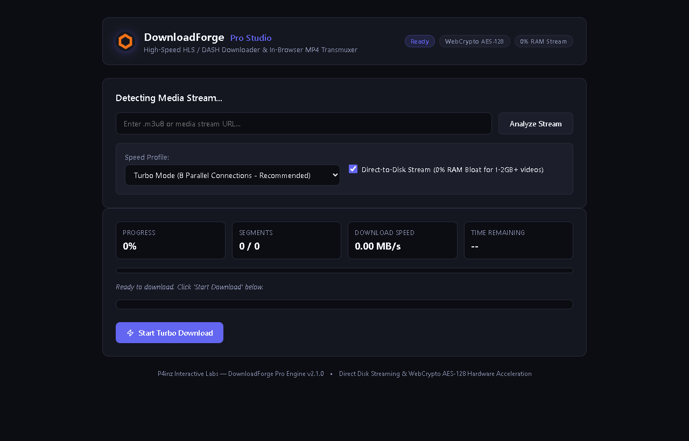
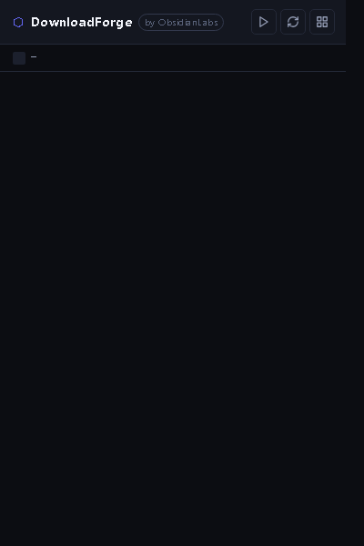
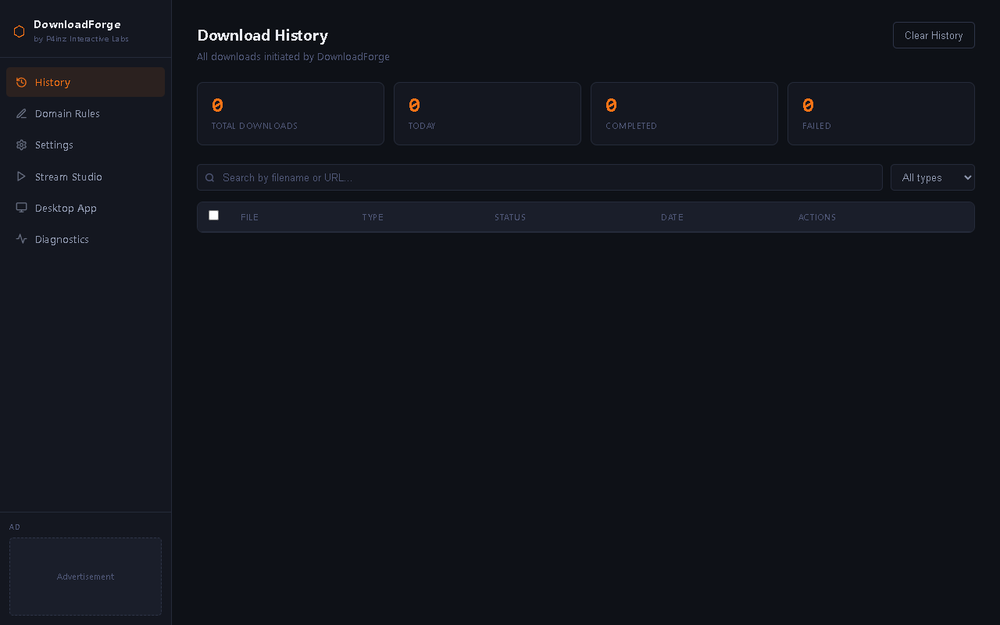

# DownloadForge Pro (v1.0.1)

**High-Performance In-Browser Video Stream Downloader & Transmuxer for Chrome (Manifest V3)**  
*Engineered by P4inz Interactive Labs — Maintained by p4inz*

[](https://github.com/p4inz-code/downloadforge-pro/releases)
[](https://developer.chrome.com/docs/extensions/mv3/intro/)
[](LICENSE)
[](#privacy--security-model)

---

DownloadForge Pro is a zero-telemetry, developer-focused Chrome extension engineered to sniff, decrypt, transmux, and download media streams from the web. It delivers full parity with and surpasses proprietary tools like FetchV by providing **multi-threaded segment fetching**, **hardware-accelerated WebCrypto AES-128 decryption**, **zero-RAM direct-to-disk streaming** (File System Access API), and an in-player floating action pill.

---

## Visual Tour

### 1. Dedicated Stream Studio (`downloader.html`)
Live visual segment heatmap, real-time throughput metrics (MB/s and ETA countdown), integrated HTML5 preview player, and multi-thread concurrency tuning.



### 2. Tab Resource Inspector Popup (`popup.html`)
Obsidian Pro glassmorphic palette, Lucide MIT vector icons, categorised media filters, and 1-click launch to Stream Studio.



### 3. Media Hub & History Manager (`dashboard.html`)
Searchable local audit log, rule engine management, and direct download replay.



---

## Key Features

### 🚀 High-Throughput HLS Ingestion Engine
- **Configurable Thread Concurrency**:
  - `Balanced` (4 workers): Stable for rate-sensitive CDNs.
  - `Turbo` (8 workers): Recommended default for high-speed broadband.
  - `Maximum` (16 workers): Saturates multi-gigabit connections.
- **Hardware AES-128 Decryption**: Uses the browser's native `window.crypto.subtle` API for multi-megabyte/sec chunk decryption without main-thread jank.
- **Dual-Track Demuxing**: Automatically extracts separated `#EXT-X-MEDIA:TYPE=AUDIO` tracks and remuxes them alongside the primary video track into standard MP4 containers.
- **Direct-to-Disk Zero-RAM Streaming**: For 1GB to 4GB+ files, DownloadForge Pro streams transmuxed chunks straight to disk using `showSaveFilePicker()` and `FileSystemWritableFileStream`, keeping the extension's memory footprint under 80 MB.
- **Live Visual Segment Heatmap**: Real-time per-chunk status grid (Queued, Fetching, Transmuxed, Error).

### 🎯 Non-Intrusive In-Player Floating Overlay
- Automatically anchors a download pill to the top-right corner of any HTML5 `<video>` element on hover.
- Displays detected resolution tag (e.g. `1080p`, `720p`, `HLS Stream`).
- Triggers instant highest-bitrate stream capture without opening the popup menu.
- Keyboard shortcut: **`Alt + D`** to toggle/download active player stream.

### 🛡️ Low-Level Request Sniffer (Main-World Bridge)
- Intercepts dynamic `window.fetch`, `XMLHttpRequest`, and `HTMLVideoElement.src` bindings at runtime.
- **MediaSource Buffer Hook**: Intercepts `SourceBuffer.prototype.appendBuffer` to capture `blob:` streams that do not expose direct manifest URLs.
- **Anti-Hotlinking Engine**: Utilizes `chrome.declarativeNetRequest` rules to strip extension headers (`Origin: chrome-extension://...`) and mirror target `Referer` headers to bypass CDN 403 anti-scrape barriers.
- **Cryptographic Nonce Handshake**: Content script and main-world sniffer communicate via session-specific token nonces to eliminate cross-extension injection attacks.

---

## Technical Architecture

```
Webpage (DOM & Media)
   │
   ├── Main-World Sniffer (injected_sniffer.js)
   │     ├─ Intercepts fetch / XHR / MSE appendBuffer
   │     └─ Posts sanitized payloads to Content Script via CustomEvent + Nonce
   │
   ├── Video Overlay Pill (video_overlay.js)
   │     └─ Floating glassmorphic download pill anchored to HTML5 <video>
   │
   └── Content Script Bridge (dist/content_script.bundle.js)
         └─ Relays stream manifests and MSE chunks to Background Worker
               │
               ▼
   Background Service Worker (service_worker.js)
         ├─ Active tab badge counters & state store
         ├─ declarativeNetRequest CDN header rules
         └─ Routes stream URLs to Stream Studio
               │
               ▼
   Stream Studio (src/downloader/downloader.html)
         ├─ hls_parser.js: Manifest, variant, key & map extraction
         ├─ hls_engine.js: Worker queue + WebCrypto AES-128
         ├─ mux.js: In-browser TS-to-fMP4 transmuxer
         └─ FileSystemWritableFileStream: Direct-to-disk write
```

---

## Keyboard Shortcuts

| Shortcut | Scope | Action |
|---|---|---|
| `Alt + D` | Webpage | Trigger download of currently focused video stream |
| `Alt + R` | Webpage | Toggle MSE buffer recording mode for `blob:` streams |
| `Escape` | Stream Studio | Abort active download job safely |

---

## Installation

### Option A: Install via Official Release Zip (Recommended)
1. Download `downloadforge-pro-v1.0.1.zip` from [Releases](https://github.com/p4inz-code/downloadforge-pro/releases).
2. Unzip the file into a folder on your drive (e.g., `Documents/downloadforge-pro`).
3. Open Google Chrome and navigate to `chrome://extensions`.
4. Enable the **Developer mode** toggle in the top-right corner.
5. Click **Load unpacked** and select the unzipped directory.
6. Pin **DownloadForge Pro** to your extension toolbar.

### Option B: Build from Source
Requirements: Node.js (v18+) and npm.

```bash
# 1. Clone repository
git clone https://github.com/p4inz-code/downloadforge-pro.git
cd downloadforge-pro

# 2. Install dependencies
npm install

# 3. Compile ESBuild bundles (dist/content_script.bundle.js & dist/downloader.bundle.js)
npm run build

# 4. Load into Chrome
# Open chrome://extensions -> Developer mode -> Load unpacked -> Select repo directory
```

---

## Privacy & Security Model

- **No Remote Telemetry**: DownloadForge Pro contains zero tracking scripts, zero Google Analytics, and zero third-party CDNs.
- **Local Transmuxing**: All TS segment processing and MP4 container packaging happen entirely inside your local browser runtime. No video data ever routes through a proxy server.
- **Strict Content Security Policy (CSP)**: Extension pages are locked down with `script-src 'self'` and `object-src 'none'`.
- **DRM Policy**: DownloadForge Pro does not decrypt or circumvent proprietary DRM systems (Widevine, PlayReady, FairPlay). Standard clear-key AES-128 streams (RFC 8216) are fully supported.

---

## Project Structure

```
downloadforge-pro/
├── manifest.json                     # Chrome MV3 manifest
├── package.json                      # Build scripts and dependencies
├── build.js                          # ESBuild pipeline
├── dist/                             # Compiled production bundles
│   ├── content_script.bundle.js      # Bundled content bridge & overlay
│   └── downloader.bundle.js          # Bundled HLS engine & mux.js
├── assets/
│   ├── icons/                        # Extension icons (16, 32, 48, 128)
│   └── screenshots/                  # Verified real UI screenshots
├── src/
│   ├── background/service_worker.js  # MV3 service worker & routing
│   ├── content/
│   │   ├── injected_sniffer.js       # Main-world fetch/XHR/MSE hook
│   │   ├── content_script.js         # Security bridge
│   │   ├── video_overlay.js          # Hover pill component
│   │   └── video_overlay.css         # Glassmorphic pill styling
│   ├── core/
│   │   ├── hls_engine.js             # Multi-threaded segment downloader
│   │   ├── hls_parser.js             # M3U8, AES-128, and audio parser
│   │   └── detector.js               # Resource type classifier
│   ├── downloader/                   # Dedicated Stream Studio UI
│   │   ├── downloader.html
│   │   ├── downloader.css
│   │   └── downloader_bundle.js
│   ├── popup/                        # Extension popup UI
│   └── dashboard/                    # Full media manager page
└── release/                          # Packaged release archives (.zip)
```

---

## License

MIT License. Designed and engineered for personal high-speed media archiving.
